<div align="center">

# 🚁 Flix 飞控 · 耀坤整理版

**从零实现的 ESP32 开源四轴飞控 —— 固件不足 2000 行 Arduino 代码，专为教学与研究而生**


**简体中文** · [**English**](README_EN.md)

</div>

---

> 📌 **本仓库是 [okalachev/flix](https://github.com/okalachev/flix) 的中文整理版。**  
> 固件源码 100% 保持上游原样（仅调整了目录位置，未改一行代码逻辑），  
> 本仓库额外提供：中文说明文档、重新规划的目录结构。  
> 上游项目与作者：[Oleg Kalachev](https://github.com/okalachev) · [项目官网 quadcopter.dev](https://quadcopter.dev)

## 📌 这是什么

Flix 是一款**专为教育和科研设计**的开源四轴飞行器固件，运行在 ESP32 系列芯片上。

它的最大特色是**极简**：固件全部用 Arduino C/C++ 写成，**不足 2000 行**，  
没有 RTOS、没有闭源库、没有黑盒算法 —— 传感器驱动、姿态解算、PID 控制、电机混控、  
MAVLink 通信全部摊开在你面前，读完就能真正理解飞控是怎么工作的。

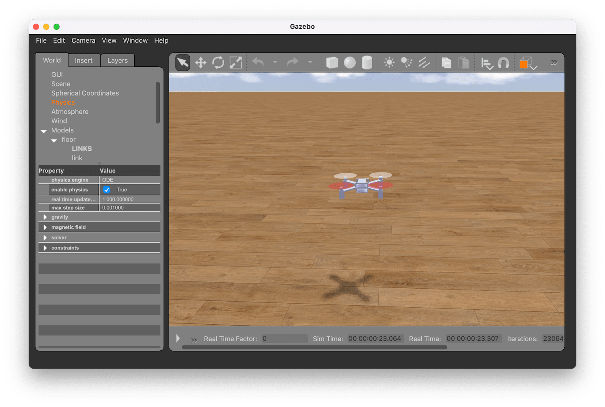

## ✨ 核心特性

| 特性             | 说明                                                      |
| -------------- | ------------------------------------------------------- |
| **极简源码**       | Arduino 编写，固件 **< 2000 行**，全部逻辑可读可改                     |
| **通用元件**       | 全部采用市面常见元件，无需定制打样即可组装                                   |
| **MAVLink 通信** | 通过 Wi-Fi 或 ESP-NOW 使用 MAVLink 协议，可用 QGroundControl 等地面站 |
| **多种操控方式**     | USB 手柄 / RC 遥控器 / 手机，Wi-Fi 与 ESP-NOW 双链路                |
| **无线命令行**      | 无需连接电脑，直接用手机/电脑连上 Wi-Fi 就能下发命令、查看状态                     |
| **Gazebo 仿真**  | 仿真器跑的是**同一份 Arduino 源码**，改固件不用等烧板子                      |
| **Python 库**   | 提供 `pyflix` 库，可用脚本编排自动飞行                                |
| **配套教材**       | 飞控理论与实践的系统教材（[持续编写中](https://quadcopter.dev)）           |
| **多芯片支持**      | ESP32 / ESP32-S3 / ESP32-C3 一份代码通吃，换板子只改 `BOARD`        |

## 🚁 真的能飞

实机演示视频：<https://youtu.be/hT46CZ1CgC4>

<a href="https://youtu.be/hT46CZ1CgC4"></a>

Version 0 演示视频：<https://youtu.be/8GzzIQ3C6DQ>

<a href="https://youtu.be/8GzzIQ3C6DQ"></a>

教育应用（RoboCamp 2025）：<https://youtu.be/Wd3yaorjTx0>

<a href="https://youtu.be/Wd3yaorjTx0"></a>

社区作品展：[Docs/user.md](Docs/user.md)

<a href="Docs/user.md">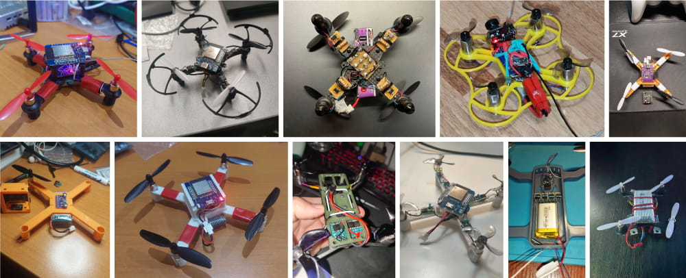</a>

## 📁 目录结构（本整理版重新整理）

> 🔧 **为什么要重整**：上游仓库把固件、文档、工具脚本平铺在根目录，  
> 目录里同时存在 `.ino` 源码、Python 脚本、mdBook 教材和 Gazebo 模型，容易看花。  
> 本整理版按"**用途**"重新分层，**固件相关的一律收进 `Firmware/`**。  
> 重要的是：`Firmware/` 内部是**一个完整可独立构建的工程**，  
> 所以在根目录执行 `make` 依然能直接编译，不需要改任何构建参数。

```text
flix/                          # ← 仓库根：说明文档 + 转发用 Makefile
├── README.md                  # 本文件（中文）
├── README_EN.md               # 英文版说明
├── Makefile                   # 转发器：把根目录的 make 转发给 Firmware/Makefile
├── Firmware/                  # ★ 固件工程（可独立构建）
│   ├── Makefile               #   真正的构建脚本（编译 / 烧录 / 仿真）
│   ├── flix/                  #   Arduino sketch —— 飞控全部源码
│   │   ├── flix.ino           #     主入口：setup / loop
│   │   ├── config.h           #     引脚定义与飞行参数
│   │   ├── imu.ino            #     IMU 驱动与校准
│   │   ├── estimate.ino       #     姿态解算
│   │   ├── control.ino        #     PID 控制与电机混控
│   │   ├── motors.ino         #     电机 / MOSFET 驱动
│   │   ├── rc.ino             #     遥控器输入
│   │   ├── mavlink.ino        #     MAVLink 协议
│   │   ├── wifi.ino           #     Wi-Fi 与 ESP-NOW 通信
│   │   ├── console.ino        #     无线命令行
│   │   ├── led.ino / power.ino / log.ino / safety.ino / time.ino / parameters.ino
│   │   └── pid.h / filter.h / quaternion.h / vector.h / util.h
│   └── gazebo/                #   Gazebo 仿真器（跑同一份 .ino 源码）
│       ├── flix.world         #     仿真世界
│       ├── simulator.cpp      #     仿真主程序
│       └── models/            #     机架 / 场景模型
├── Docs/                      # ★ 文档与教材
│   ├── assembly.md            #   组装说明
│   ├── usage.md               #   编译 / 调试 / 飞行
│   ├── firmware.md            #   固件架构总览（强烈推荐先读）
│   ├── troubleshooting.md     #   故障排查
│   ├── log.md                 #   日志分析
│   ├── user.md                #   社区作品展
│   └── book/                  #   mdBook 飞控教材
├── Tools/                     # ★ 工具脚本
│   ├── pyflix/                #   Python 飞控库
│   ├── espnow-proxy/          #   ESP-NOW 代理固件
│   ├── csv_to_ulog/           #   CSV → ULog 转换
│   └── log.py / fft.py / test.py ...
└── .github/workflows/         # CI：编译验证 + 文档构建 + 工具测试
```

**整理前后对照：**

| 原始路径       | 整理后路径                         | 理由                  |
| ---------- | ----------------------------- | ------------------- |
| `flix/`    | `Firmware/flix/`              | Arduino 固件源码        |
| `gazebo/`  | `Firmware/gazebo/`            | 仿真器跑同一份固件，属固件工程一部分  |
| `Makefile` | `Firmware/Makefile`（+ 根目录转发器） | 构建脚本跟固件走；根目录留转发器保兼容 |
| `docs/`    | `Docs/`                       | 文档                  |
| `tools/`   | `Tools/`                      | 工具脚本                |

## 🚀 快速开始

### 1. 编译固件

需要先安装 [arduino-cli](https://arduino.github.io/arduino-cli/latest/installation/)。

```bash
git clone https://github.com/YaoKunS/flix.git
cd flix
git checkout yaokun-organized   # ★ 切到耀坤整理版分支（默认 master 是上游原版结构）

# 首次运行会自动下载 ESP32 core 3.3.10 与依赖库（FlixPeriph / MAVLink）
make                                    # 默认编译 ESP32
make BOARD=esp32:esp32:esp32s3          # 编译 ESP32-S3
make BOARD=esp32:esp32:esp32c3          # 编译 ESP32-C3
```

> 💡 `make` 在根目录可用 —— 根目录的 `Makefile` 会自动转发到 `Firmware/`。  
> 也可以 `cd Firmware && make`，效果完全一样。

### 2. 烧录与调试

```bash
make upload                 # 编译并烧录
make monitor                # 打开串口监视器（115200）
make erase                  # 擦除 bootloader
```

### 3. 运行 Gazebo 仿真

不想买硬件也能先玩起来（需要 Gazebo 11）：

```bash
make build_simulator
make simulator
```

### 4. 无线遥控

编译烧录 `ESP-NOW` 代理固件：

```bash
make upload_proxy
```

连上飞机的 Wi-Fi（AP 名称见串口日志），即可用浏览器或地面站操控。

## 🔌 硬件清单

| Type             | Part                                                                                                                                                                                                |                                                                         Image                                                                         | Quantity |
| ---------------- | --------------------------------------------------------------------------------------------------------------------------------------------------------------------------------------------------- | :---------------------------------------------------------------------------------------------------------------------------------------------------: | :------: |
| 主控板              | ESP32 Mini<br />也支持 ESP32-S3 / ESP32-C3                                                                                                                                                             |                                                        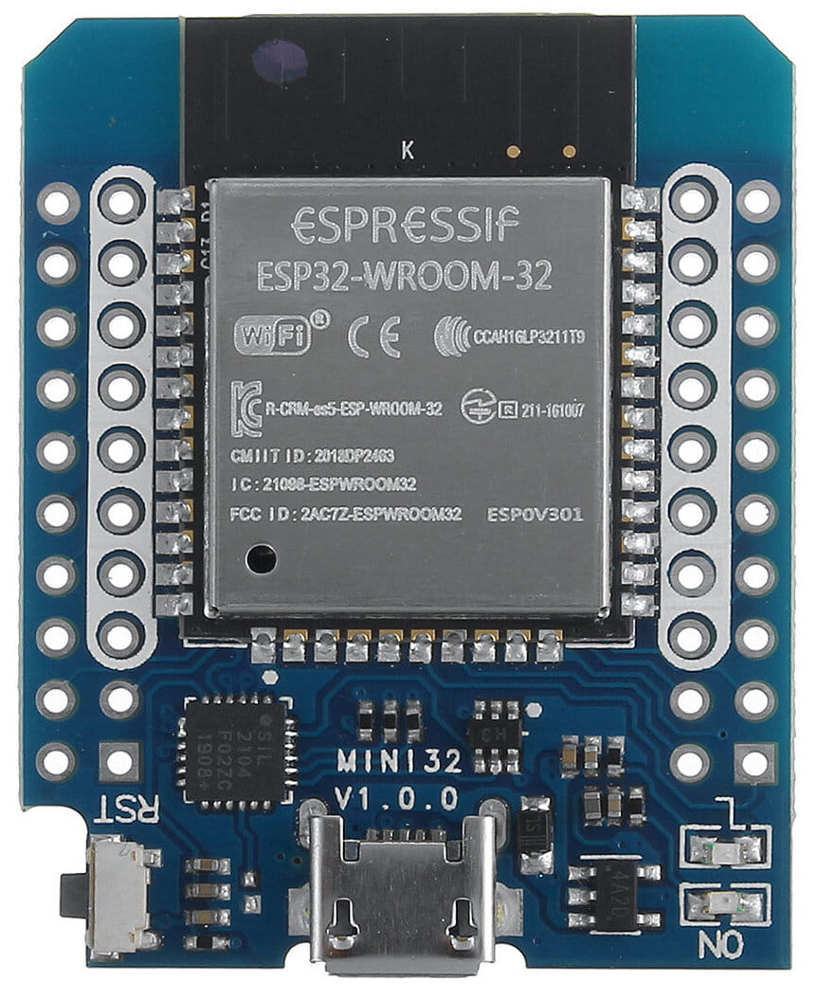                                                       |     1    |
| IMU¹             | GY-91、MPU-9265（或其它 MPU-9250 / MPU-6500）<br />ICM20948V2<br />GY-521（MPU-6050）                                                                                                                       | 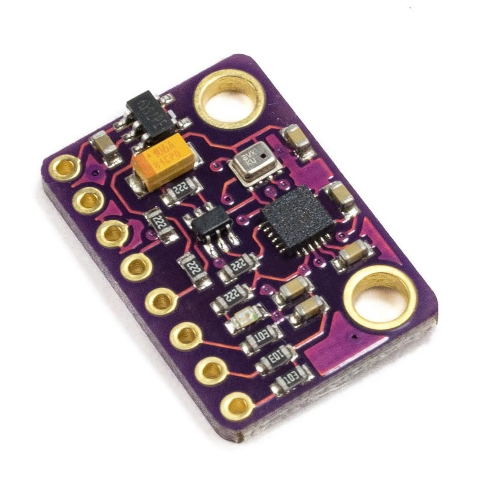<br />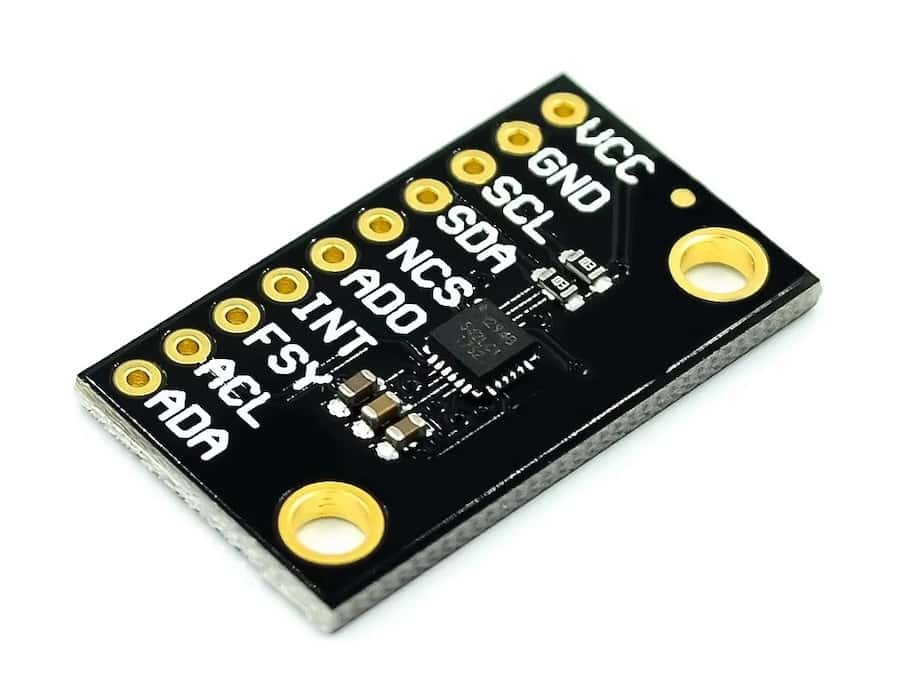<br />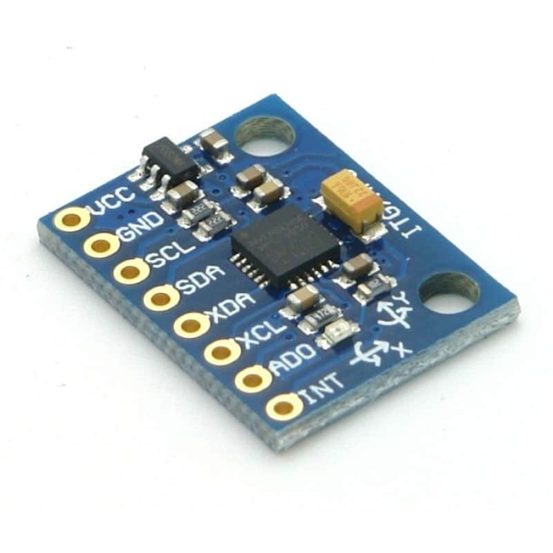 |     1    |
| *升压模块（可选，供电更稳）*  | *5V 输出*                                                                                                                                                                                             |                                                     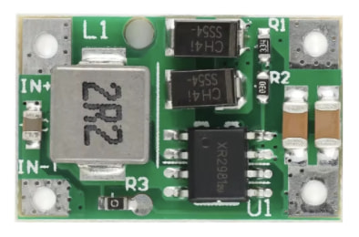                                                     |     1    |
| 电机               | 8520 3.7V 有刷电机<br />**必须是标称 3.7V，不能是工作电压区间（3.7V–6V）**<br />确认电机轴径与桨孔径匹配！                                                                                                                            |                                                       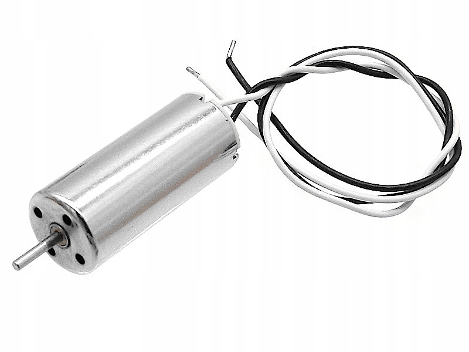                                                       |     4    |
| 桨叶               | 55 mm 或 65 mm                                                                                                                                                                                       |                                                        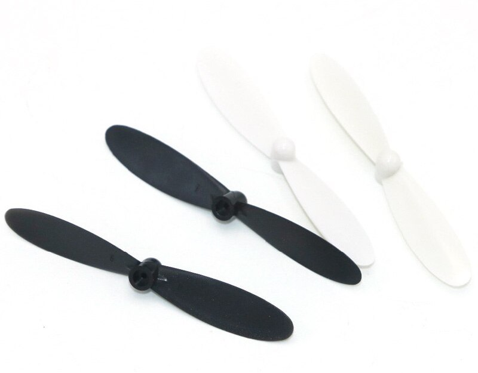                                                        |     4    |
| MOSFET           | UMW 100N03A 或[类似型号](https://t.me/opensourcequadcopter/33)<br />⚠️ **不要用 KIA 100N03A 等杂牌，可能不工作！**                                                                                                    |                                                       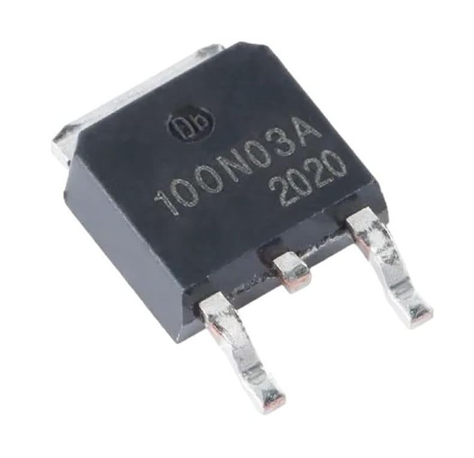                                                      |     4    |
| 下拉电阻<br />电压采样电阻 | 10 kΩ                                                                                                                                                                                               |                                                     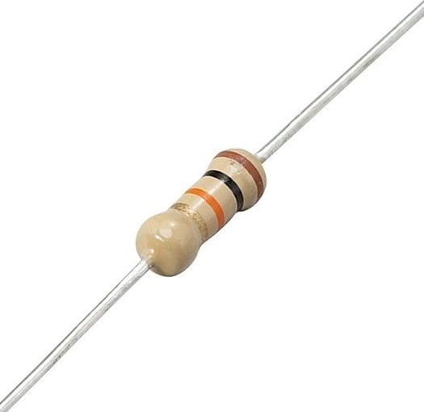                                                    |     6    |
| 3.7V 锂电池         | LW 952540（或同尺寸兼容型号）<br />建议 25C 1000 mAh 以上！                                                                                                                                                        |                                                       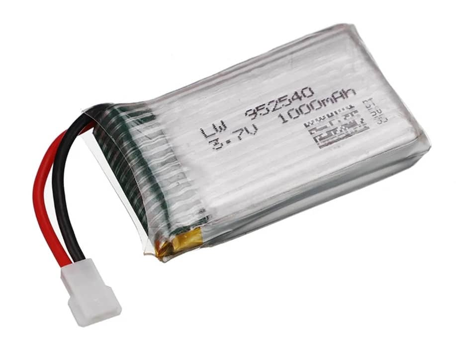                                                      |     1    |
| 电池线              | MX2.0 2P 母座                                                                                                                                                                                         |                                                         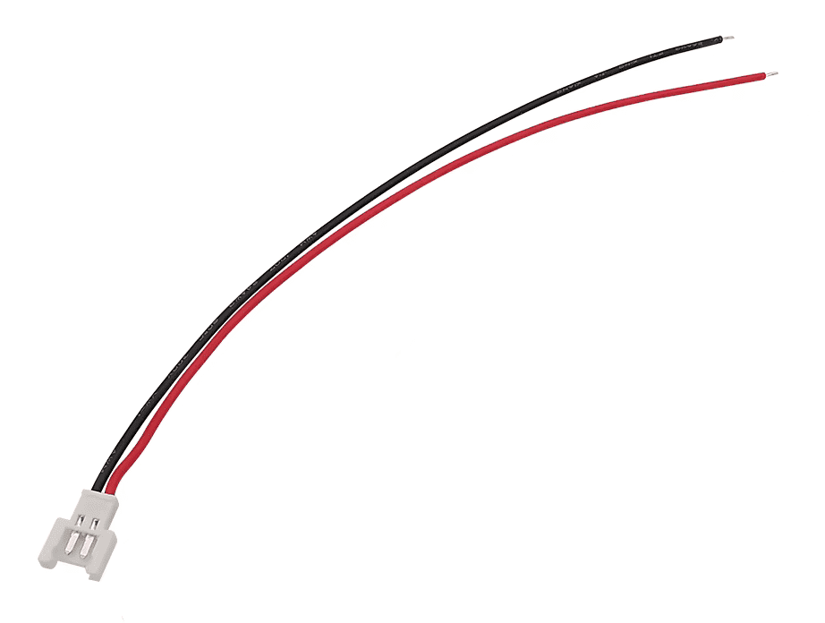                                                         |     1    |
| 锂电池充电器           | 任意                                                                                                                                                                                                  |                                                       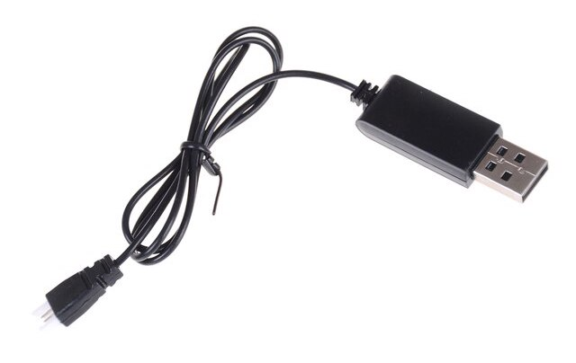                                                      |     1    |
| IMU 板固定螺钉        | M3x5                                                                                                                                                                                                |                                                      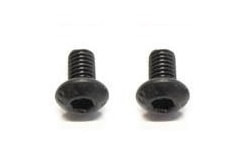                                                      |     2    |
| 机架装配螺钉           | M1.4x5                                                                                                                                                                                              |                                               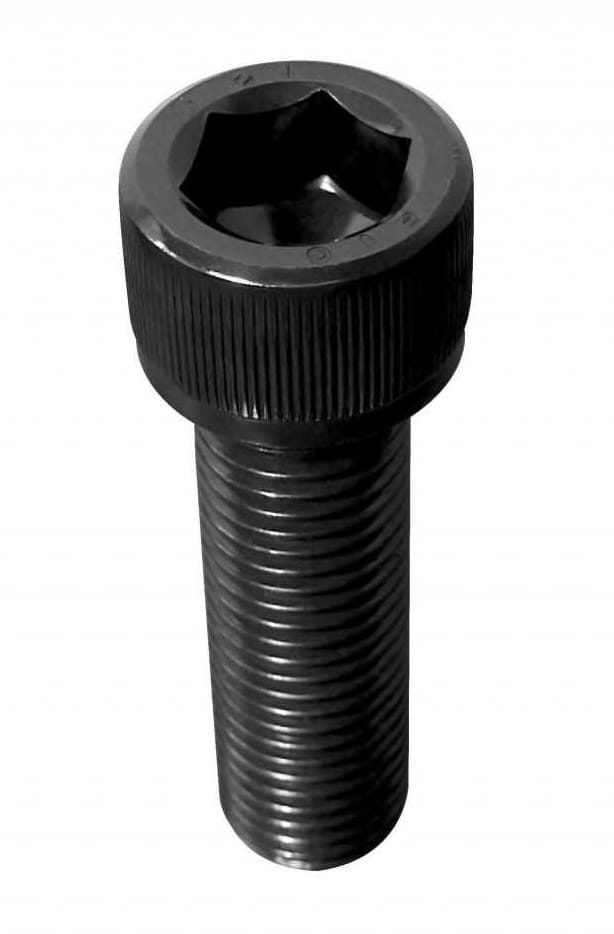                                              |     4    |
| 机架主体             | 3D 打印²：[`stl`](Docs/assets/flix-frame-1.1.stl) [`step`](Docs/assets/flix-frame-1.1.step)<br />推荐参数：层高 0.2 mm，线宽 0.4 mm，填充 100%。                                                                     |                                                       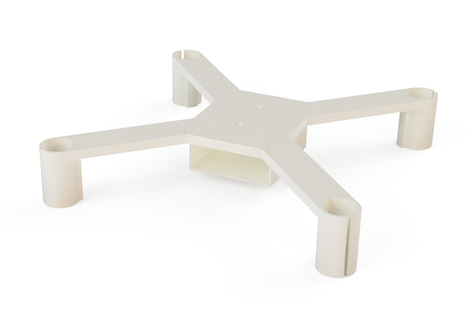                                                       |     1    |
| 机架上盖             | 3D 打印：[`stl`](Docs/assets/esp32-holder.stl) [`step`](Docs/assets/esp32-holder.step)                                                                                                                 |                                                    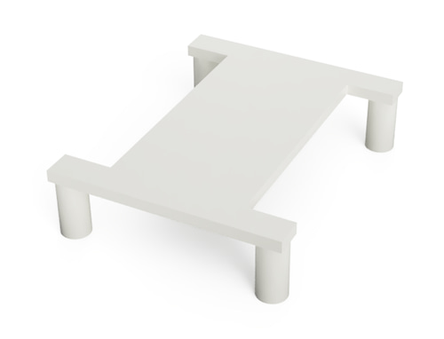                                                    |     1    |
| IMU 板垫片          | 3D 打印：[`stl`](Docs/assets/washer-m3.stl) [`step`](Docs/assets/washer-m3.step)                                                                                                                       |                                                      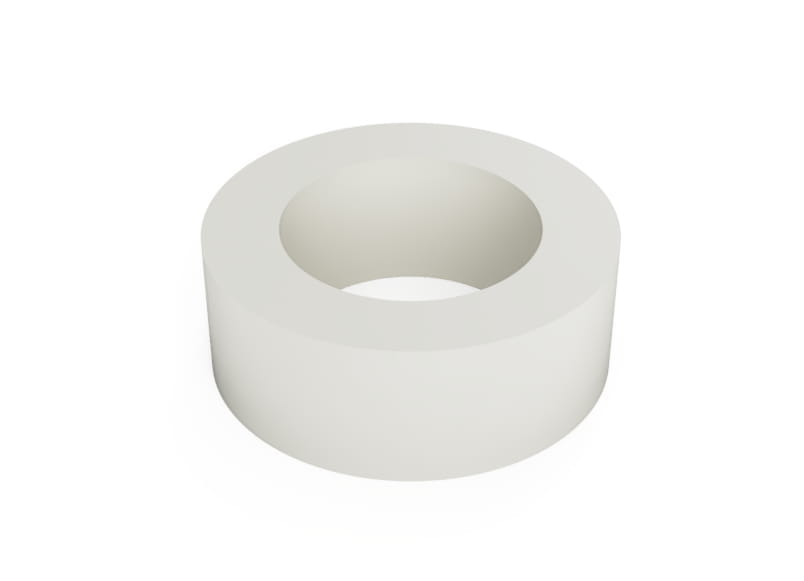                                                     |     2    |
| 遥控器（推荐）          | CC2500 发射器，如 BetaFPV LiteRadio CC2500（RC 接收 + Wi-Fi）<br />双摇杆手柄（仅 Wi-Fi）——见[推荐手柄列表](https://docs.qgroundcontrol.com/master/en/qgc-user-guide/setup_view/joystick.html#supported-joysticks)<br />其它⁵ |                                  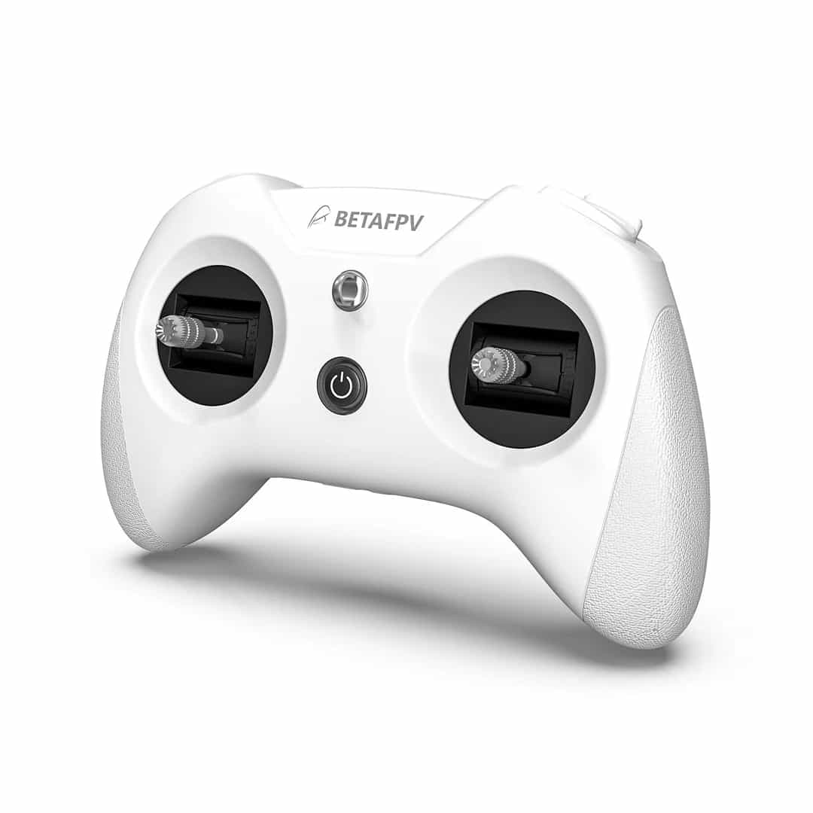                                 |     1    |
| *RC 接收机（可选）*     | *DF500 或其它³*                                                                                                                                                                                        |                                                         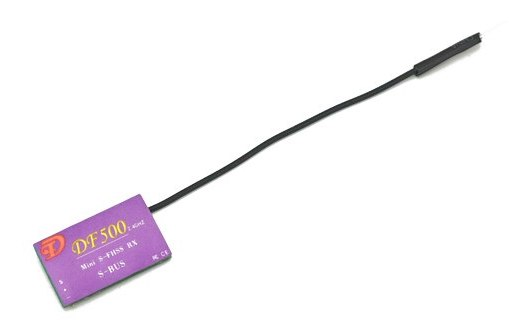                                                         |     1    |
| 导线               | 推荐 28 AWG                                                                                                                                                                                           |                                                     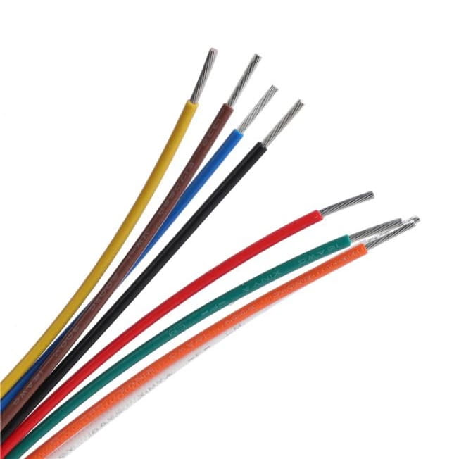                                                     |          |
| 胶带、双面胶           |                                                                                                                                                                                                     |                                                                                                                                                       |          |

*¹ — 目前气压计未使用。*  
  
*² — 此机架为 GY-91 板优化，换其它板需修改固定孔位。*  
  
*³ — 也可用任何 SBUS 接口的发射机 / 接收机组合。*

组装所需工具：3D 打印机、烙铁、助焊焊锡、螺丝刀、万用表。

欢迎自由修改设计与代码，做出你自己的改进版本。  
成果可发到[官方 Telegram 群](https://t.me/opensourcequadcopterchat)，  
或直接联系作者（[E-mail](mailto:okalachev@gmail.com) · [Telegram](https://t.me/okalachev)）。

## 🔧 接线图

### 简化连接图

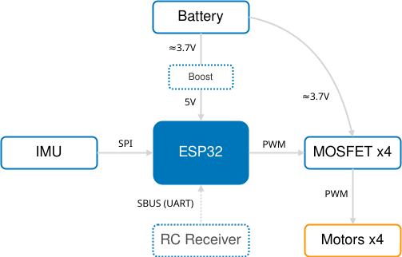

*（虚线框内为可选元件。）*

电机连接方案：

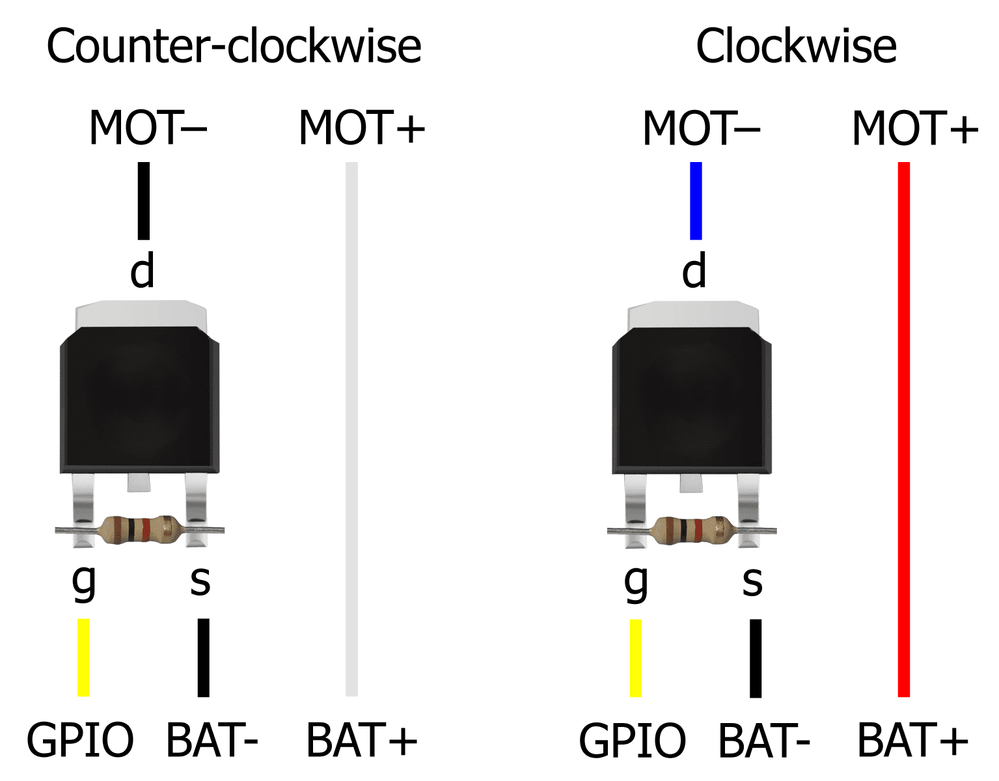

社区贡献的[完整电路图变体](https://miro.com/app/board/uXjVN-dTjoo=/?moveToWidget=3458764612338222067\&cot=14)。

### 接线要点

- 用锂电池的 VCC（+）与 GND（−）给 ESP32 Mini 供电。
- IMU 板通过 VSPI 接入 ESP32 Mini，供电用 3.3V 与 GND：
  | IMU 引脚       | ESP32 引脚     |
  | ------------ | ------------ |
  | GND          | GND          |
  | 3.3V         | 3.3V         |
  | SCL *(SCK)*  | SVP (GPIO18) |
  | SDA *(MOSI)* | GPIO23       |
  | SAO *(MISO)* | GPIO19       |
  | NCS          | GPIO5        |
- MOSFET 必须焊接下拉电阻。
- 电机经 MOSFET 接 ESP32 Mini：
  | 电机      | 位置 | 转向  | 桨型 | 电机线   | GPIO           |
  | ------- | -- | --- | -- | ----- | -------------- |
  | Motor 0 | 左后 | 逆时针 | B  | 黑 & 白 | GPIO12 *(TDI)* |
  | Motor 1 | 右后 | 顺时针 | A  | 蓝 & 红 | GPIO13 *(TCK)* |
  | Motor 2 | 右前 | 逆时针 | B  | 黑 & 白 | GPIO14 *(TMS)* |
  | Motor 3 | 左前 | 顺时针 | A  | 蓝 & 红 | GPIO15 *(TD0)* |
  顺时针电机配蓝红线，对应 A 型桨（桨上有标记）；逆时针电机配黑白线，对应 B 型桨。
- RC 接收机可选接入 ESP32 的 UART2：
  | 接收机引脚       | ESP32 引脚             |
  | ----------- | -------------------- |
  | GND         | GND                  |
  | VIN         | VCC（按接收机而定，也可用 3.3V） |
  | Signal (TX) | GPIO4                |
- 电池电压分压采样可选接入任意 ADC1 引脚（如 ESP32 的 *GPIO32*、ESP32-S3 的 *GPIO3*）。

  ESP32 与 ESP32-S3 [最多可测](https://docs.espressif.com/projects/arduino-esp32/en/latest/api/adc.html#analogsetattenuation) 3.1 V，  
  ESP32-S3 / ESP32-C3 最多 2.5 V，请据此选择分压电阻。

## 📚 推荐阅读顺序

刚接触飞控的话，**按这个顺序读，半天就能搞懂原理**：

1. [固件架构总览](Docs/firmware.md) —— 数据怎么流动、控制怎么闭环
2. [组装说明](Docs/assembly.md) —— 把机器装起来
3. [使用手册](Docs/usage.md) —— 编译、调试、飞行
4. [飞控教材](Docs/book/) —— 姿态解算、坐标系、陀螺仪原理
5. [故障排查](Docs/troubleshooting.md) —— 起飞异常时先看这里
6. [日志分析](Docs/log.md) —— 用 PlotJuggler 分析飞行数据

更多：

- [仿真器说明](Firmware/gazebo/README.md)
- [Python 库文档](Tools/pyflix/README.md)
- [社区作品展](Docs/user.md)

## 🔌 社区资源

- 开发频道（俄语）：<https://t.me/opensourcequadcopter>
- 官方 Telegram 群（英/俄）：<https://t.me/opensourcequadcopterchat>
- 开发历程长文（俄语）：<https://habr.com/ru/articles/814127/>
- 飞控教材网站：<https://quadcopter.dev>

## 📜 开源协议与致谢

- **上游项目**：Flix © [Oleg Kalachev](https://github.com/okalachev) ·  
  源码仓库 <https://github.com/okalachev/flix>
- **本整理版**：仅做中文文档与目录整理，**未修改固件逻辑**，固件版权归原作者所有。
- **本仓库整理**：耀坤智联 YaoKunSmart · <https://github.com/YaoKunS>
- **B 站**：<https://space.bilibili.com/3707011699050767>

> ⚠️ **关于许可证的重要说明**：


> 上游 [okalachev/flix](https://github.com/okalachev/flix) 仓库**目前未附带任何 LICENSE 文件**，  
> 也未在 README 中声明具体开源许可证名称。这意味着严格来说，  
> **版权默认保留给原作者**（著作权法默认「未授权」）。  
> 因此本整理版**不擅自添加** LICENSE 文件，也不会替作者选择许可协议 ——  
> 这属于原作者的决定。  
> 本仓库仅作学习研究与技术交流用途；如需商业使用或再分发，  
> 请先联系原作者取得明确授权，并遵守所在地法律法规。

> ⚠️ 使用、修改、分发本项目时，请保留上游作者署名与项目出处。

## ⚠️ 免责声明

这是一个 DIY（自己动手）项目，希望你觉得它有趣且有用。  
但它并不容易组装和调试，且**按"现状"提供，不附带任何担保** ——  
不保证它能完美工作，甚至不保证它能工作。

⚠️ 作者不对使用本项目造成的任何损坏、伤害或损失负责。**风险自负！**  
飞行时请务必在空旷场地试飞，并遵守当地无人机法规。

---

<div align="center">

**🚁 Flix** · 由 [Oleg Kalachev](https://github.com/okalachev) 倾力打造  
· 本中文整理版由 [耀坤智联](https://github.com/YaoKunS) 维护

</div>
